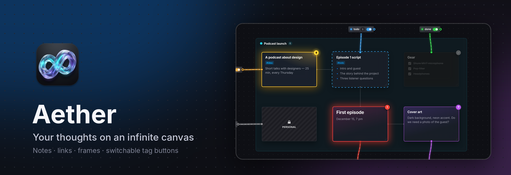
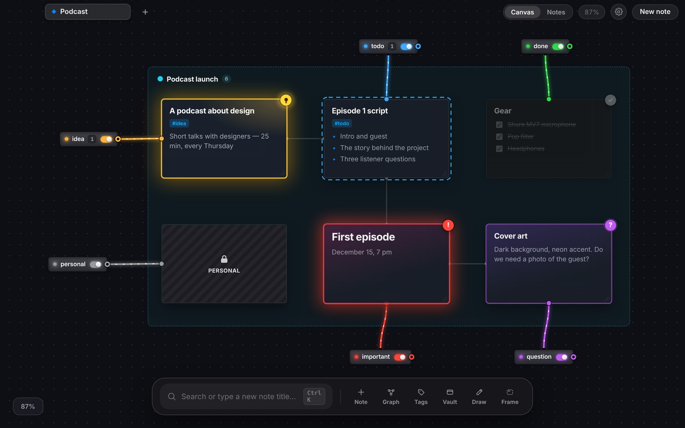
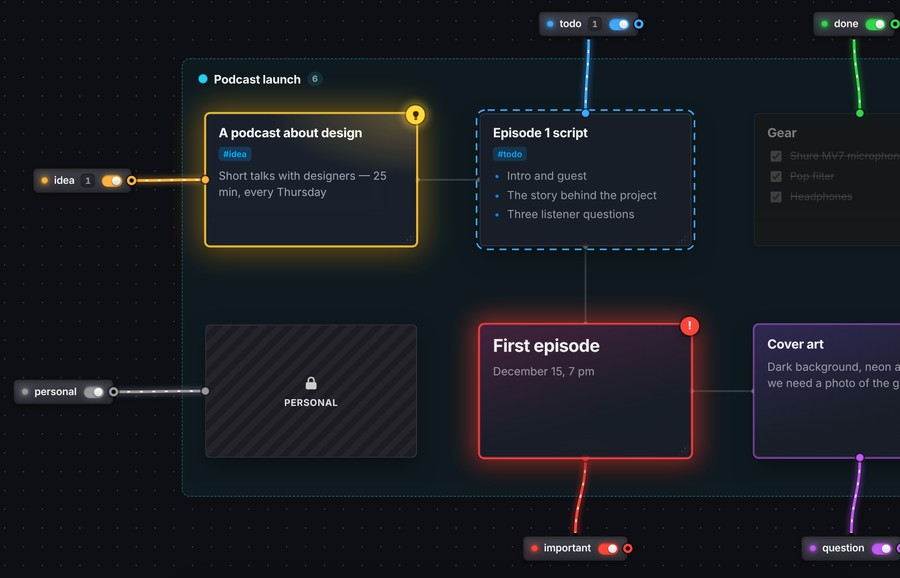
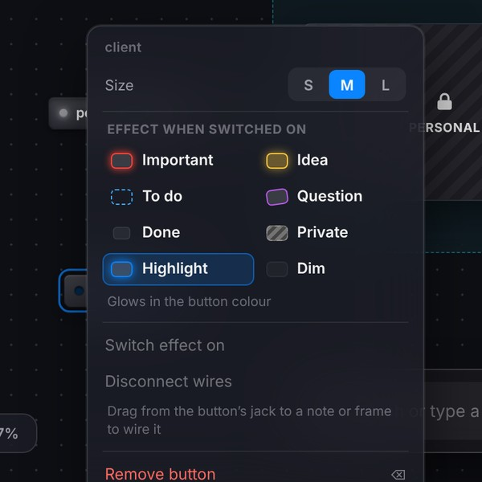
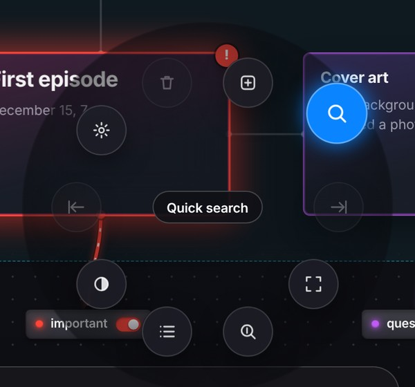
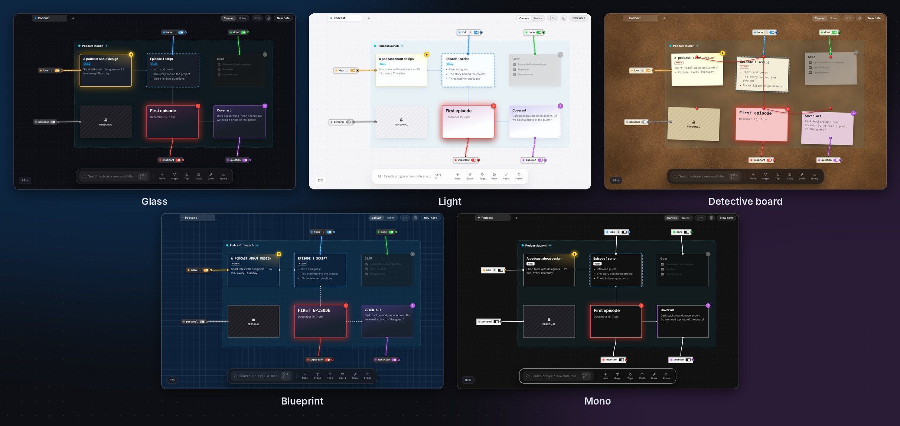
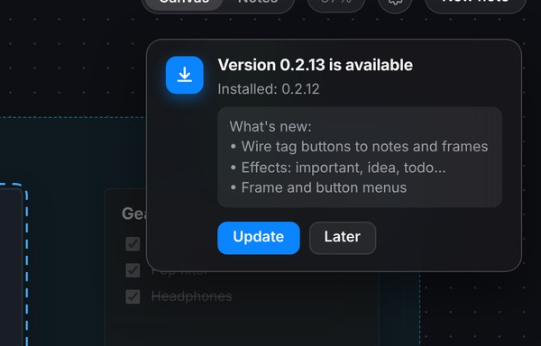

<p align="center">
  
</p>

<p align="center">
  <a href="https://github.com/yanteezy/aether-vault/releases/latest"></a>
  <a href="https://github.com/yanteezy/aether-vault/releases"></a>
  
  
</p>

<p align="center">
  <a href="https://github.com/yanteezy/aether-vault/releases/latest/download/Aether-macOS.dmg"></a>
  &nbsp;
  <a href="https://github.com/yanteezy/aether-vault/releases/latest/download/Aether-Windows-Setup.exe"></a>
</p>

<p align="center">
  <sub>Free · no account · your notes never leave your computer · <a href="https://github.com/yanteezy/aether-vault/releases">all releases</a></sub>
</p>

---

**Aether** is a spatial notebook. Instead of a list of files you get an endless canvas:
drop notes anywhere, connect them with lines, group them into frames, sketch on top —
and flip a switch to make whole groups of notes light up, step back or hide.

<p align="center">
  
</p>

## ✨ Features

### 🗒️ An infinite canvas for your notes
- **Notes anywhere.** Double-click the canvas to create one; drag, resize, colour and pin it.
- **Six note styles** — plain, headline, caps, banner, quote and bullet list — each with its own text size and title alignment.
- **Links.** Pull a line from the edge of one note to another to show how ideas connect.
- **Frames.** Wrap notes into a group — move the frame and everything inside comes along. Right-click for colour, size and lock.
- **Ink.** Draw arrows, circles and highlights with a pen, marker and eraser. Draw on a note and the sketch becomes part of it — it moves, copies and deletes with the note. Free drawings can be clicked, dragged and deleted.
- **Photos.** Paste, drop or add a picture to any note — fill or fit, move, zoom and darken it under the text. Drop a photo on empty canvas to get a picture note.
- **Smart links.** Paste a YouTube, GitHub, Figma, Google Docs, Notion, Spotify… link and get a card with the service, a readable title (and a preview for YouTube) that opens in your browser. Links inside notes are clickable.
- **Tabs.** Keep separate workspaces side by side — work, study, a side project — each with its own theme if you like.
- **Undo everything.** <kbd>Ctrl</kbd> / <kbd>⌘</kbd> + <kbd>Z</kbd> undoes any change on the board, <kbd>Ctrl</kbd> / <kbd>⌘</kbd> + <kbd>X</kbd> / <kbd>C</kbd> / <kbd>V</kbd> cut, copy and paste notes, buttons, frames and drawings.
- **Select anything.** <kbd>Ctrl</kbd> / <kbd>⌘</kbd> + drag or <kbd>Ctrl</kbd> / <kbd>⌘</kbd> + <kbd>A</kbd> picks up notes, buttons and frames together — move or delete them as one.
- **Fonts.** Pick a font for all notes in Settings, or right-click a note to give it its own — system, serif, rounded, monospace, typewriter or handwritten.

### 🔌 Tag buttons you can wire up
Place a button on the canvas, pull a cable from its jack to any note or frame, then flip the switch:

<table>
<tr>
<td width="58%"></td>
<td>

| Button | What it does |
|---|---|
| 🔴 **important** | Pulsing red glow, on top of everything |
| 💡 **idea** | Warm glow and a light bulb |
| 🔵 **todo** | Marching dashed outline |
| 🟣 **question** | Purple outline and a pulsing «?» |
| ✅ **done** | Steps back under other notes and turns grey |
| 🔒 **personal** | Content hidden behind a frosted shutter |

Make your own buttons and pick any effect — including **highlight** and **dim** — and choose **S / M / L** size.

</td>
</tr>
</table>

<p align="center">
  
  &nbsp;
  
</p>

### ⚡ Fast to move around
- **Radial menu** — hold <kbd>Alt</kbd> / <kbd>⌥</kbd> and flick towards an action.
- **Quick search** — press <kbd>Space</kbd> and type; a title that doesn't exist yet becomes a new note.
- **Zoom** with the wheel or a pinch — towards the middle of the board, or under the cursor if you prefer.

### 🎨 Five themes

<p align="center">
  
</p>

Plus accent colour, glass blur, card opacity, corner radius, text size, grid and animation speed — all in **Settings** (<kbd>Ctrl</kbd> / <kbd>⌘</kbd> + <kbd>,</kbd>). The interface speaks **English** and **Ukrainian** — you choose on first launch, and the built-in guide follows your choice.

### 🔄 Updates itself


When a new version is out, Aether shows what's new and installs it in one click — your notes stay exactly where they were.
Updates are signed, so the app only accepts versions published here.

<br clear="right">

### 🔐 Private by design
No account, no cloud, no tracking. Everything you write is stored locally on your computer.
The only thing Aether ever asks the internet is «is there a newer version?».

## 📦 Install

**macOS** (Apple Silicon & Intel, macOS 12+)
1. Download **[Aether-macOS.dmg](https://github.com/yanteezy/aether-vault/releases/latest/download/Aether-macOS.dmg)**, open it and drag Aether into **Applications**.
2. The app isn't signed with an Apple developer certificate yet, so the first launch is blocked.
   Open **System Settings → Privacy & Security**, scroll down and click **Open Anyway**. You only need to do this once.

**Windows** (10 / 11)
1. Download **[Aether-Windows-Setup.exe](https://github.com/yanteezy/aether-vault/releases/latest/download/Aether-Windows-Setup.exe)** and run it — no admin rights needed.
2. If Windows shows *«Windows protected your PC»*, click **More info → Run anyway**.

## ⌨️ Shortcuts

| Action | macOS | Windows |
|---|---|---|
| Quick search | <kbd>Space</kbd> | <kbd>Space</kbd> |
| Search / new note field | <kbd>⌘</kbd> <kbd>K</kbd> | <kbd>Ctrl</kbd> <kbd>K</kbd> |
| Radial menu | hold <kbd>⌥</kbd> | hold <kbd>Alt</kbd> |
| Edit selected note | <kbd>Enter</kbd> | <kbd>Enter</kbd> |
| Duplicate note | <kbd>⌘</kbd> <kbd>D</kbd> | <kbd>Ctrl</kbd> <kbd>D</kbd> |
| Undo / redo | <kbd>⌘</kbd> <kbd>Z</kbd> / <kbd>⌘</kbd> <kbd>⇧</kbd> <kbd>Z</kbd> | <kbd>Ctrl</kbd> <kbd>Z</kbd> / <kbd>Ctrl</kbd> <kbd>Y</kbd> |
| Cut / copy / paste | <kbd>⌘</kbd> <kbd>X</kbd> <kbd>C</kbd> <kbd>V</kbd> | <kbd>Ctrl</kbd> <kbd>X</kbd> <kbd>C</kbd> <kbd>V</kbd> |
| Select all | <kbd>⌘</kbd> <kbd>A</kbd> | <kbd>Ctrl</kbd> <kbd>A</kbd> |
| Delete selection | <kbd>⌫</kbd> | <kbd>Delete</kbd> |
| Next / previous tab | <kbd>⌘</kbd> <kbd>⌥</kbd> <kbd>→</kbd> / <kbd>←</kbd> | <kbd>Ctrl</kbd> <kbd>Tab</kbd> / <kbd>Ctrl</kbd> <kbd>⇧</kbd> <kbd>Tab</kbd> |
| Drawing: pen / marker / eraser | <kbd>P</kbd> <kbd>M</kbd> <kbd>E</kbd> | <kbd>P</kbd> <kbd>M</kbd> <kbd>E</kbd> |
| Settings | <kbd>⌘</kbd> <kbd>,</kbd> | <kbd>Ctrl</kbd> <kbd>,</kbd> |

New to Aether? **Settings → General → Guide** opens a tab with notes about every feature.

## 🛠️ Build from source

Aether is built with [Tauri 2](https://tauri.app), React 19, TypeScript and Vite.

```bash
npm install
npm run app:dev   # desktop window with hot reload
npm run dev       # or just the web UI at http://localhost:1420
```

Releases are built and signed by GitHub Actions — see [`docs/DEVELOPMENT.md`](docs/DEVELOPMENT.md) (in Ukrainian) for the full guide.
