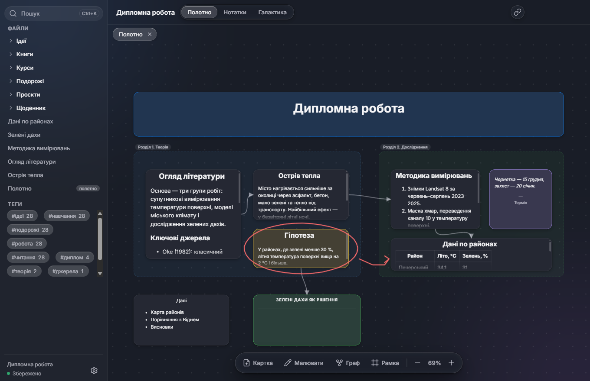
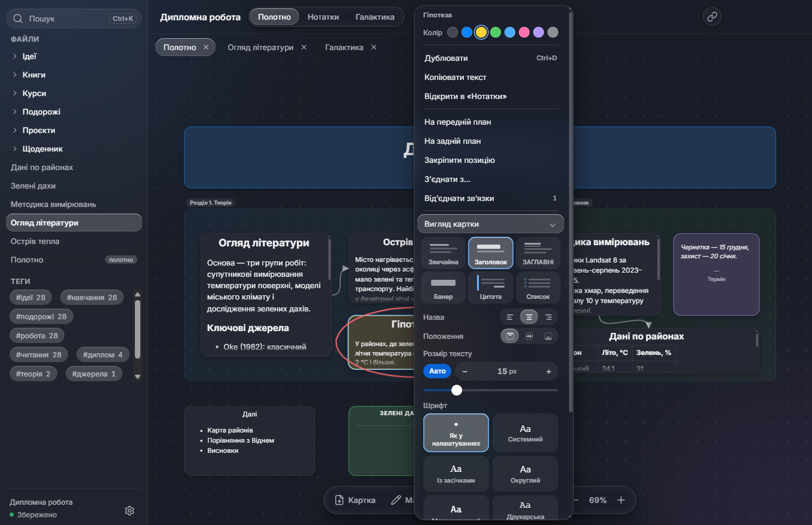
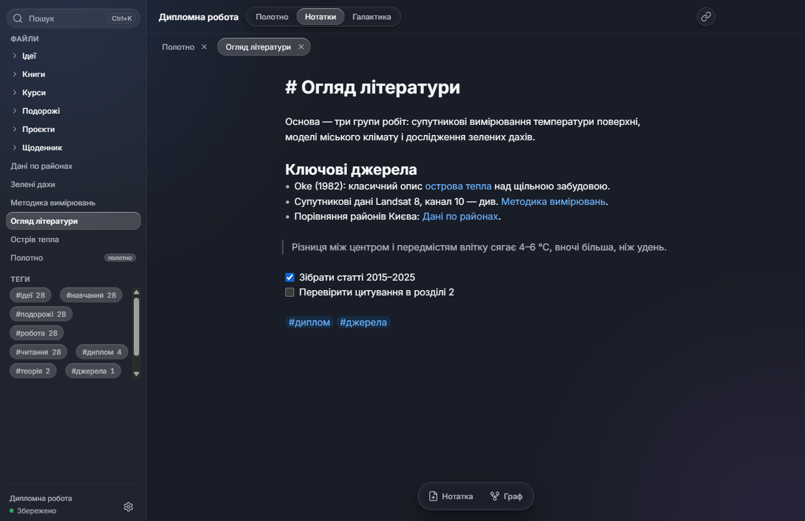
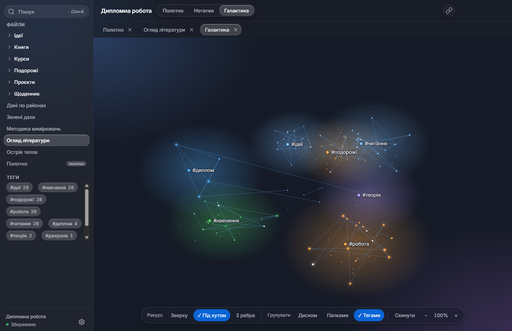
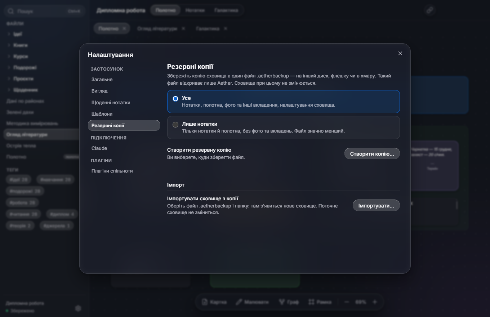

# Aether

Aether is a note-taking app for Windows and macOS built around a spatial canvas. Notes are plain Markdown files in an ordinary folder, and canvases use the open JSON Canvas format, so the same vault opens in Obsidian and in any text editor. The interface is in Ukrainian.

Aether є нотатником для Windows і macOS, побудованим навколо полотна. Нотатки зберігаються як звичайні файли Markdown у вашій папці, полотна у відкритому форматі JSON Canvas, тож те саме сховище відкривається в Obsidian і в будь-якому текстовому редакторі.



[Завантажити останню версію](https://github.com/yanteezy/aether-vault/releases/latest): `Aether-Setup-<версія>.exe` для Windows, `Aether-<версія>-mac.dmg` для macOS.

## Сховище

Сховище є звичайною папкою на диску. Кожна нотатка є окремим файлом `.md`, кожне полотно є файлом `.canvas`, фото лежать у `attachments/`. Службові дані Aether (відкриті вкладки, малюнки на полотні, налаштування) зберігаються в прихованій папці `.aether` поруч. Окремої бази даних немає: якщо видалити Aether, файли залишаться на місці й читатимуться без нього. Сховищ може бути скільки завгодно, а перемикаються вони кнопкою з назвою сховища внизу ліворуч.

## Полотно

Картку можна створити подвійним кліком, кнопкою «Картка» в доку або перетягнути на полотно наявну нотатку з бічної панелі. У меню картки (права кнопка) є шість типів: звичайна, заголовок, великі літери, банер, цитата та список. Для кожної можна задати колір, шрифт і розмір тексту, вирівнювання та положення назви, фото на тлі, а також закріпити її на місці. Теги з бічної панелі перетягуються прямо на картку.

Картки з'єднуються стрілками від точок на краях, групуються в рамки, змінюють порядок шарів. Режим «Малювати» відкриває в доку смужку кольорів: чотири останні використані й вибір будь-якого іншого. Малюнки поводяться як об'єкти: їх можна виділяти (Ctrl+клік або рамкою з Ctrl), перетягувати, вирізати й вставляти, ставити над карткою чи під неї. Дії, які не скасувати звичайним способом, показують повідомлення з десятисекундним відліком і кнопкою «Скасувати»; на полотні працюють Ctrl+Z і Ctrl+Shift+Z.



## Нотатки

Редактор Markdown показує форматування одразу під час набору: заголовки, списки, задачі, цитати, таблиці, код. Посилання `[[Назва нотатки]]` ведуть на інші нотатки, панель зворотних посилань показує, хто посилається на поточну. Є пошук по сховищу (Ctrl+K), теги з лічильниками, щоденні нотатки, шаблони та граф зв'язків.



## Галактика

Третій вид поряд із полотном і нотатками показує сховище як 3D-галактику. Кожна нотатка й кожна текстова картка полотна є зіркою, лінії між ними повторюють посилання та стрілки. Зірки можна розкласти спіральним диском, скупченнями за папками або за тегами. Розмір зірки залежить від кількості зв'язків, яскравість від того, як давно нотатку змінювали. Клік показує картку нотатки, Enter відкриває її, F лишає видимими тільки сусідів. Сцену малює WebGL2, граф будується у фоновому потоці з кешем: сховище на 10 000 нотаток відкривається приблизно за півсекунди повторно і за 1,5 с уперше.



## Резервні копії

У налаштуваннях, вкладка «Резервні копії», можна зберегти сховище в один файл `.aetherbackup`: повністю, з фото та вкладеннями, або лише нотатки й полотна. Файл відкриває тільки Aether, і пошкоджену копію він помітить замість того, щоб відновити зіпсовані дані. Імпорт створює з копії нове сховище в окремій папці й нічого наявного не перезаписує.



## Плагіни та Claude

Aether запускає плагіни спільноти Obsidian, бо повторює їхній API (`obsidian.d.ts`); перевірено на популярних плагінах, але не на всіх. Плагіни мають повний доступ до системи, тому вмикаються лише після того, як ви довірите сховищу.

Вкладка «Claude» підключає сховище до Claude Desktop або Claude Code через MCP-сервер, який тільки читає: Claude може шукати по нотатках і полотнах, бачити відкриту нотатку та виділені картки, але нічого не змінює.

## Оновлення

Aether перевіряє нові версії на GitHub через кілька секунд після запуску й далі кожні 6 годин. Коли версія з'являється, у кутку вікна виникає повідомлення з кнопками «Оновити» і «Пізніше»; перед перезапуском усі нотатки зберігаються. Перевірити вручну можна в налаштуваннях, вкладка «Загальне». На macOS застосунок не підписаний сертифікатом Apple і не може оновити себе сам, тому кнопка відкриває сторінку релізу.

## Перехід зі старого Aether

Версії до 0.2.24 зберігали нотатки у власному форматі. Після оновлення до 0.3.0 перший екран пропонує перенести їх: кожне старе сховище стає папкою в «Документи\Aether», картки, стрілки, рамки, малюнки й фото переносяться на свої місця. Старі дані тільки читаються і залишаються незмінними, а старий застосунок лишається встановленим, доки ви не видалите його самі. Під час видалення не позначайте пункт про видалення даних застосунку.

## Розробка

Electron 45 і TypeScript без UI-бібліотек. Інтерфейс збирається esbuild, головний процес компілюється `tsc`.

```
npm ci
npm start          # зібрати й запустити
npm test           # юніт-тести (Vitest)
npm run smoke      # перевірка в справжньому вікні (Playwright + Electron)
npm run dist       # інсталятор Windows у release/
```

Як влаштований застосунок і чому зроблено саме так, описано в [docs/ARCHITECTURE.md](docs/ARCHITECTURE.md). Знімки для цього файлу оновлює `node scripts/screenshots.mjs` після `npm run build`.

## Випуск версії

1. Підніміть `version` у `package.json` і допишіть зверху рядок у `RELEASE_NOTES.md`.
2. Створіть і надішліть тег: `git tag v<версія>` і `git push origin v<версія>`. Workflow `.github/workflows/release.yml` збере Windows і macOS та створить чернетку релізу.
3. Перевірте чернетку й опублікуйте її. Встановлені застосунки бачать лише опубліковані релізи.

Для старого Aether 0.2.x реліз містить `latest.json`, підписаний ключем із секретів `TAURI_SIGNING_PRIVATE_KEY` і `TAURI_SIGNING_PRIVATE_KEY_PASSWORD`. Новий застосунок оновлюється через `latest.yml` і від цих секретів не залежить.
