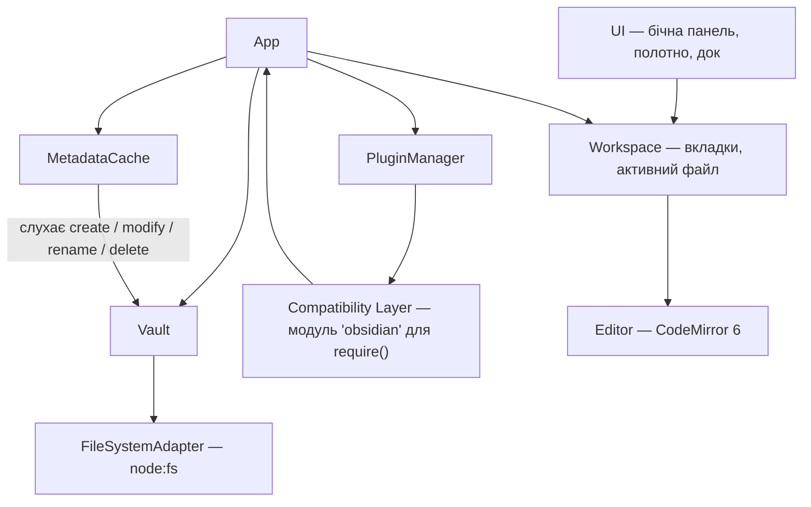

# Aether (прототип) — архітектура

Новий застосунок, окремий від старого Aether. Мета — нотатник на `.md`-файлах, у якому працюють плагіни спільноти Obsidian.
Джерела для сумісності: публічний `obsidian.d.ts` (npm-пакет `obsidian`, ліцензія MIT), docs.obsidian.md, відкритий код плагінів. Код Obsidian (`app.asar`) не розпаковується.

## 1. Стек, дані, події

**Стек.** TypeScript + Electron (Chromium і Node.js в одній програмі). Плагіни Obsidian — це CommonJS-файл `main.js`, який викликає `require('obsidian')`, а часто й `require('fs')`, `require('path')`, `require('electron')`. Тому сторінка працює з `nodeIntegration: true` і `contextIsolation: false`, як в Obsidian (`src/main/main.ts`). Ціна: кожен плагін має повний доступ до системи, тож вмикати їх має сам користувач.

**Дані.**
- Нотатки — звичайні `.md`-файли в папці сховища, вони й є джерелом правди.
- Налаштування застосунку й плагінів — у `.aether/` (`vault.configDir`), дані плагіна — у `.aether/plugins/<id>/data.json`. Папки, що починаються з крапки, у дерево файлів не потрапляють.
- Видалене через `trash` переходить у `.trash/`.
- Кеш метаданих поки живе в пам'яті. Далі — IndexedDB (вбудована база браузера) з ключем «шлях + час зміни + розмір», щоб не розбирати всі файли при кожному старті.
- Окрема база даних не потрібна: усе, крім файлів, — кеш, який можна перебудувати.

**Події ядра** (назви як в Obsidian):

| Модуль | Подія | Навіщо |
| --- | --- | --- |
| Vault | `create(file)`, `modify(file)`, `delete(file)`, `rename(file, oldPath)` | Зміни файлів. При старті `create` летить для кожного файлу |
| MetadataCache | `changed(file, data, cache)` | Нотатку розібрано наново |
| | `deleted(file, prevCache)` | Кеш видаленого файлу прибрано |
| | `resolve(file)` | Посилання цього файлу визначено |
| | `resolved()` | Усі посилання визначено |
| Workspace (крок 3) | `layout-change`, `active-leaf-change`, `file-open`, `editor-change`, `file-menu`, `editor-menu`, `css-change`, `resize`, `quit` | Вкладки, редактор, меню, тема |
| Plugin (крок 4) | `onload` / `onunload` | Усе, що зареєстровано через `registerEvent`, `addCommand`, `addSettingTab`, знімається автоматично |

## 2. Модулі



```
src/
  main/main.ts              процес Electron: вікно
  core/
    events.ts               Events, EventRef
    vault/files.ts          TAbstractFile, TFile, TFolder, normalizePath
    vault/adapter.ts        FileSystemAdapter (атомарний запис, без перезапису)
    vault/vault.ts          Vault
    metadata/parse.ts       .md → CachedMetadata
    metadata/metadataCache.ts
    metadata/tags.ts        getAllTags (текст + frontmatter)
  app/                      сторінка (збирає esbuild у dist/app)
    index.ts                старт: останнє сховище або екран вибору
    app.ts                  App + оболонка «Скла» (бічна панель, шапка, вкладки, док)
    dom.ts                  createEl / createDiv / empty / addClass … на всіх елементах
    icons.ts                setIcon / addIcon
    component.ts            Component, Plugin, PluginSettingTab
    workspace.ts            Workspace, WorkspaceLeaf, View, ItemView, FileView
    ui.ts                   Modal, Notice, Setting і його контроли
    commands.ts             команди, гарячі клавіші, палітра (Ctrl/⌘+P)
    editor/                 Editor (API Obsidian над CodeMirror 6), живий перегляд, MarkdownView
    views/fileExplorer.ts   дерево файлів і теги
    plugins/                PluginManager, модуль `obsidian`, вікно налаштувань
  styles/                   theme.css (змінні з назвами Obsidian), app.css
scripts/                    build.mjs (esbuild), smoke.mjs (Playwright + справжній Electron)
```

## 3. Редактор і DOM/CSS-сумісність

- **Редактор** — CodeMirror 6, як в Obsidian. Плагіни отримують ті самі екземпляри `@codemirror/*` і `@lezer/*`, що й застосунок, і `editor.cm`.
- **Живий перегляд.** Позначки Markdown (`#`, `**`, `[[ ]]`, лапки коду) сховані на всіх рядках, крім того, де курсор. Класи — як у тем Obsidian: `HyperMD-header-N`, `cm-header-N`, `cm-strong`, `cm-em`, `cm-hmd-internal-link`, `cm-hashtag`, `cm-inline-code`, `HyperMD-codeblock`, `HyperMD-quote`.
- **Посилання.** Клік по посиланню переходить (на рядку з курсором — Ctrl/⌘+клік), з клавіатури — Alt+Enter. Посилання в нікуди створює нотатку.
- **Збереження.** Через 400 мс після останнього натискання, при перемиканні файлу, закритті вкладки і перед закриттям вікна. Помилку запису видно в статусі й у сповіщенні, текст лишається в редакторі.
- **DOM.** `.app-container > .horizontal-main-container > .workspace`, бокові `.workspace-split.mod-left-split` / `.mod-right-split`, `.workspace-tabs`, `.workspace-leaf > .workspace-leaf-content[data-type] > .view-header + .view-content`, `.markdown-source-view.mod-cm6.is-live-preview`, `.nav-files-container .tree-item .nav-file-title`, `.modal-container > .modal`, `.setting-item`, `.status-bar-item`.
- **Розміщення за макетом.** Шапка 56px і плаваючий док — свої елементи. Кнопки стрічки плагінів (`addRibbonIcon`) стають у док, елементи рядка стану (`addStatusBarItem`) — унизу бічної панелі.

## 4. Плагіни

- Папка: `.aether/plugins/<id>/` з `manifest.json`, `main.js`, `styles.css`; дані — `data.json`; список увімкнених — `.aether/community-plugins.json`. Формат як в Obsidian.
- `main.js` виконується як CommonJS. `require('obsidian')` дає наш модуль, `@codemirror/*` — спільні екземпляри, решта (`fs`, `path`, `electron`) — справжні модулі Node / Electron.
- Життєвий цикл: `onload` (може бути async) → усе, що зареєстровано (`registerEvent`, `addCommand`, `addRibbonIcon`, `addStatusBarItem`, `addSettingTab`, `registerView`, `registerEditorExtension`, `registerDomEvent`, `registerInterval`), знімається на `unload` автоматично.
- **Безпека.** Плагіни сховища запускаються лише після «Довіряю» — один раз для сховища. До того діє безпечний режим.
- Помилка в плагіні не ламає застосунок: вона показується у сповіщенні, а сліди плагіна прибираються.

## 5. MetadataCache

- **`CachedMetadata`** — опис нотатки, у кожного елемента `position` (рядок, колонка, зсув):
  - `links` — `[[Нотатка|текст]]` і `[текст](файл.md)`;
  - `embeds` — `![[фото.png]]`;
  - `tags` — `#тег` у тексті;
  - `headings` — заголовки з рівнем;
  - `frontmatter` — YAML на початку файлу;
  - `sections` — блоки: yaml, heading, paragraph, list, blockquote, code.

  Що в коді чи в інлайн-коді — не рахується.
- **`resolvedLinks`** — `{ файл: { ціль: скільки разів } }`, **`unresolvedLinks`** — те саме для посилань без файлу.
- **Пошук цілі** — `getFirstLinkpathDest(link, sourcePath)`: точний шлях, далі файл із такою назвою в тій самій папці, далі найкоротший шлях. Регістр не важливий.
- **Коли оновлюється.** Подія Vault ставить файл у чергу. Файл розбирається, летить `changed`. Коли черга порожня, посилання визначаються наново, летять `resolve` для змінених файлів і `resolved`.
- **Перейменування.** Текст посилань в інших файлах кеш не змінює: це завдання FileManager, як в Obsidian.

## Дизайн — «Скло (macOS)», лише макет для прототипу

Inter 400–700, темна тема. Фон `#151a26` з плямами `#3b5b8f` і `#5a3f7a`. Вікно з відступом 28px і радіусом 22px. Бічна панель 248px, шапка 56px, крапкова сітка 22px, док унизу.
Значення стануть CSS-змінними з назвами Obsidian (`--background-primary`, `--text-normal`, `--interactive-accent`, …) на кроці 3. Конкретні рішення щодо вигляду погоджуються з користувачем.

## Зроблено після кроків 3–4 (0.2.1 – 0.2.3)

- **Перевірка на справжніх плагінах** — `node scripts/plugins-check.mjs`: вмикає кожен плагін із `test-vault/.aether/plugins` на копії сховища (вікно на другому моніторі), показує помилки й API, якого бракує (`app.plugins.missingApi`). Зараз без помилок: Better Word Count, Advanced Tables, Calendar, Natural Language Dates, Outliner, Tag Wrangler.
- **Додане API:** `moment`, `EditorSuggest`/`PopoverSuggest`/`Scope`, `Menu`/`MenuItem`, `Keymap`, `editorInfoField`, делеговані `el.on/off`, `leaf.getContainer`, `Vault.recurseChildren`, `parseFrontMatter*`, `getCachedFiles`/`getTags`, `FileManager` (`renameFile` з виправленням посилань, `processFrontMatter`, `generateMarkdownLink`, `trashFile`), `MarkdownRenderer`/`MarkdownRenderChild`, `registerMarkdownPostProcessor`/`registerMarkdownCodeBlockProcessor`, `requestUrl`/`request` (через основний процес, без CORS), усі іконки Lucide.
- **Режим читання** (Ctrl/⌘+E): marked → DOMPurify (без очищення HTML з нотатки мав би доступ до Node) → блоки `<div>` → обробники плагінів. Посилання ніколи не ведуть вікно геть: `will-navigate` заборонено, веб-посилання відкриваються в браузері.
- **Файли в інтерфейсі:** контекстне меню (правий клік, Shift+F10, клавіша меню), F2, Delete → `.trash`, «Перемістити до…» і перетягування в папки; подія `file-menu` для плагінів.
- **Зовнішні зміни:** `fs.watch` → події create / modify / delete; власні записи не дублюються.
- **Вкладки між запусками:** `.aether/workspace.json`.
- **Запис файлів:** записи одного файлу йдуть по черзі, тимчасові файли унікальні (на Windows одночасні перейменування падали з EPERM).

## Полотно (0.3.0)

- Файли `.canvas` у форматі JSON Canvas 1.0, як в Obsidian: `src/core/canvas/canvasData.ts` (читання, запис табами, геометрія) і `src/app/canvas/canvasView.ts` (вид). Перемикач «Полотно» відкриває `Полотно.canvas` у корені сховища (створює, якщо нема); «Нове полотно» — у меню папки й команді.
- Картки: текстові (Markdown, подвійний клік — редагування), нотатки з файлів (вміст нотатки; подвійний клік — відкрити), рамки (групи — рухаються з усім, що всередині). Посилання-картки (`link`) лише показуються.
- Зв'язки: тягнути від точки на краю картки до іншої; або «З'єднати з…» в меню картки. Підпис — подвійний клік по зв'язку або пункт меню.
- Мишею: перетягування — рух/панорама, колесо — прокрутка, Ctrl+колесо і кнопки доку — масштаб, кут — розмір, нотатку з дерева файлів можна перетягнути на полотно.
- Клавіатурою: Tab по картках, стрілки рухають (Shift — на 50px, Alt — змінюють розмір), Enter — редагувати/відкрити, Delete — видалити, Shift+F10 — меню, Escape — зняти вибір, Ctrl+Z / Ctrl+Shift+Z / Ctrl+Y — скасувати й повторити (за `e.code`, тож на будь-якій розкладці).
- Скасування: стек знімків `{ data, strokes }` (до 100), знімок — перед кожною зміною; перетягування — один крок. Перечитання файлу з диска стек очищає.
- Кольори карток: 6 шаблонів JSON Canvas (`'1'`…`'6'`) і «Без кольору» в меню картки (для всього виділеного).
- Малювання: кнопка «Малювати» (aria-pressed), Escape — вийти. Лінії не належать до JSON Canvas і лежать у `.aether/canvas-extra/<шлях полотна, / → __>.json` (`{ strokes: [{ id, points, width, color? }] }`), тож коли змінюються лише малюнки, `.canvas` не переписується. Файл, що не прочитався, не переписується; при перейменуванні полотна він переїжджає слідом.
- Не нищимо чуже: невідомі поля файлу, карток і зв'язків зберігаються; файл, який не вдалося прочитати, не переписується.
- Поки нема: кольори зв'язків з інтерфейсу (з файлу показуються), вбудовані веб-сторінки в link-картках, мінімапа.

## Реліз (Windows)

- `npm run build` — збірка для розробки (sourcemaps, без мінімізації). `npm run build:prod` — релізна: мінімізовані JS і CSS, без sourcemaps, `process.env.NODE_ENV = "production"` (`node scripts/build.mjs --prod`).
- `npm run dist` — релізна збірка + інсталятор electron-builder (налаштування — ключ `build` у `package.json`): NSIS для Windows x64, з вибором папки встановлення. Результат — `release/Aether Setup <версія>.exe`, розпакована програма — `release/win-unpacked/`. Папка `release/` не комітиться.
- У пакет (`app.asar`) потрапляють лише `dist/**`, `index.html`, `package.json`. `node_modules` не потрібні: esbuild вбудовує всі залежності в `dist/app/index.js`, лишаються тільки модулі Node і `electron`. Якщо колись знадобиться залежність під час роботи — додати її в `files` явно.
- Перевірка пакета: `node scripts/package-smoke.mjs` запускає `release/win-unpacked/Aether.exe` на тимчасовому сховищі (вікно на другому моніторі), друкує в нотатку й перевіряє файл. Сам інсталятор тест не запускає.
- **Не зроблено:**
  - Підпис коду. Без нього Windows SmartScreen попереджає при встановленні. Щоб додати: сертифікат лишається в користувача, electron-builder бере його зі змінних `CSC_LINK` (шлях або base64 `.pfx`) і `CSC_KEY_PASSWORD` (або `win.azureSignOptions` для Azure Trusted Signing). У репозиторій ключі не потрапляють.
  - Автооновлення й публікація (`publish`) — нема, інсталятор нікуди не завантажується.
  - Збірка для macOS — лише на Mac (на Windows не збирається), там же підпис і нотаризація Apple.
  - Власна іконка — поки стандартна іконка Electron.

## Після 0.4.0

- **Швидкість** (`node scripts/perf.mjs 10000`, ціль — відкриття за 2–3 с): дерево зі 10 000 нотаток видно за ~0,9 с від запуску; повне індексування — ~9 с у фоні; пошук у тексті ~55 мс; граф ~5 с у Web Worker (вікно не зависає).
- **Зміни іншої програми під час редагування:** тристороннє злиття по рядках (`src/core/merge.ts`). Різні місця — об'єднуються; ті самі рядки — у редакторі лишається ваш текст, а чужа версія зберігається поруч як «Назва (зміни іншої програми).md».
- **Каталог плагінів:** Налаштування → Плагіни спільноти → «Огляд…». Список — `obsidianmd/obsidian-releases`, файли — з релізу плагіна на GitHub за версією з його `manifest.json`. id перевіряється (лише безпечне ім'я теки, збіг з обома маніфестами). Встановлення не вмикає плагін. Перевірка у справжньому вікні: `node scripts/catalog-check.mjs "Dataview,Templater,Excalidraw"`.

## З Aether 0.2.24 (0.7.0)

- **Контекстне меню картки** (правий клік, Shift+F10, клавіша меню) — той самий склад, що в Aether: редагувати, тип нотатки (6 стилів), вирівнювання назви, розмір тексту (Авто / px), шрифт, фото (додати / замінити / прибрати, заповнити / вмістити, затемнення), розмір Ш × В, колір (8 кольорів), дублювати, копіювати текст, відкрити в «Нотатки» (текстова картка стає нотаткою), передній / задній план, закріпити позицію, з'єднати / від'єднати, видалити (другий клік підтверджує). Код: `src/app/canvas/noteMenu.ts`, стилі `src/styles/note-menu.css`. Властивості Aether лежать у вузлі JSON Canvas під ключами `aether-*` (Obsidian їх зберігає, але не показує). Фото копіюються в `attachments/`.
- **Шрифти** (`src/app/appearance.ts`): 7 системних шрифтів, розмір тексту карток 10–32 px, «Авторозмір тексту» (площа картки, 0.9–1.3×), окремо для картки й загально в Налаштування → Вигляд; той самий шрифт у редакторі й режимі читання.
- **Гарячі клавіші полотна:** Ctrl/⌘+D дублювати, Ctrl+C / X / V копіювати / вирізати / вставити картки (текст з інших програм — нова картка), Ctrl+A виділити все, P — малювати (натиснути — до Escape, тримати — поки тримаєш), Пробіл — пошук, Enter / F2 — редагувати, Ctrl+Z / Y — назад / вперед. Клавіші — за фізичною клавішею (будь-яка розкладка).
- **Escape** скасовує незавершену дію: перетягування, зміну розміру, малювання лінії, з'єднання, прокрутку — усе повертається як було; без дії — знімає виділення без синьої рамки фокуса (Tab повертає рамку).
- Перетягування на полотні ніколи не виділяє текст сторінки.
- **Світло курсора** (`src/app/glassLight.ts`, `src/styles/glass-light.css`): у колі ~140 px навколо курсора край скла світлішає й товщає в бік курсора, всередині — м'яке сяйво. Один `pointermove` + `requestAnimationFrame`, лише елементи в радіусі; вимикається з Reduce Motion / Reduce Transparency / Increase Contrast.
- Запис файлів на Windows повторює перейменування кілька разів, якщо файл на мить тримає антивірус (EPERM / EBUSY).

## 0.7.3

- **Кілька карток:** Ctrl / ⌘ + клік додає картку до виділення або прибирає з нього; Ctrl / ⌘ + перетягування по порожньому полотну — рамка, що додає всі картки, яких торкається (Escape — скасувати). Меню вибраної картки діє на все виділення: колір, тип, вирівнювання, шрифт, розмір тексту, розмір, закріплення, порядок, дублювання, копіювання тексту, від'єднання, видалення («Вибрано карток: N»).
- **Теги в бічній панелі:** при наведенні (або фокусі з клавіатури) праворуч вискакує скляна бульбашка × (bouncy) і втягується назад, коли курсор іде (snappy). × прибирає тег з усіх нотаток — з тексту (не з коду) і з frontmatter — після підтвердження.
- Запис файлу: якщо Windows повідомила про помилку перейменування, а повтор каже, що тимчасового файлу вже немає, вміст файлу перевіряється — без збігу збереження вважається невдалим.

## 0.7.4

- **Теги вручну** (`src/app/tagStore.ts`): «Новий тег…» додає тег у список цього сховища — `.aether/tags.json`, видно лише в цій папці. У меню тегу «Зберігати всюди» переносить його у список застосунку (localStorage `aether-global-tags`) — тоді він є в «Тегах» кожного сховища (позначка-глобус). Тег без нотаток показано з лічильником 0; «Прибрати тег» викидає його з обох списків.
- **Меню порожньої бічної панелі** (права кнопка): Нова нотатка, Нова папка…, Нове полотно, Новий тег…, Новий воркспейс… (відкрити іншу папку).
- Меню закривається на `pointerdown` поза ним — полотно скасовує mouse-події натискання, тож `mousedown` не доходив.
- Панель «Зворотні посилання» має відступ зверху під кнопки вікна ОС.

## 0.7.5

- **Тег перетягується на нотатку:** пігулку тегу з лівої панелі можна кинути на нотатку в дереві файлів або на картку полотна (ціль підсвічується пунктиром). Нотатка (і картка-нотатка) отримує тег у frontmatter `tags` — його видно в пошуку й «Тегах». Текстова картка полотна тримає теги у полі вузла `aether-tags`.
- Теги картки показано дрібно в її правому нижньому куті; картка-нотатка оновлює їх, щойно змінився кеш метаданих нотатки.

## 0.7.6

- **Меню картки → «Прибрати тег #…»** (по пункту на кожен тег, лише для однієї картки): з картки-нотатки тег зникає з файлу — і з тексту, і з frontmatter (`removeTag(app, tag, [file])`); з текстової картки — з поля `aether-tags` (можна скасувати Ctrl+Z).

## 0.7.7

- **Налаштування → Вигляд, меню картки:** загальне правило для кнопок у налаштуваннях більше не перебиває плитки шрифтів і кроковий лічильник (виключення `:not(...)`). Лічильник розміру — одна капсула з − / число / + на одній лінії, повзунок рівно під нею. Плитки шрифтів вищі (≥ 60 px), назви переносяться, без «…»; у меню картки — 2 стовпці.
- **Перемикач:** не айфонівський — прямокутна доріжка з заокругленням 9 px, квадратний бігунок; увімкнений — колір акценту і галочка на бігунку (стан не лише кольором), рух `--spring-snappy`.

## 0.7.8

- **Видалення плагіна:** у «Плагіни спільноти» біля перемикача кожного плагіна — кнопка-кошик («Видалити плагін …»). Після підтвердження `PluginManager.uninstallPlugin(id)` вимикає плагін (команди, панелі, стилі, слухачі знімаються, `community-plugins.json` оновлюється) і переносить його папку разом із `data.json` у `.trash` сховища — повернути можна, перенісши папку назад.

## 0.7.9

- **Повідомлення «Скасувати» з відліком** (`src/app/undoToast.ts`): для дій, яких не бере Ctrl+Z, — видалення файлу / папки в кошик, тег з усіх нотаток (× на тезі, меню тегу), тег з картки-нотатки, видалення плагіна. Дія виконується одразу (без «Ви впевнені?»), внизу над доком з'являється скляна капсула: кружок, що 6 с спорожнюється з кінця, з числом секунд, текст і «Скасувати». Наведення або фокус ставлять відлік на паузу (WCAG 2.2.1); при `prefers-reduced-motion` кружок крокує щосекунди.
- Повернення справжнє: файл — `Vault.restoreFromTrash(шлях у .trash, шлях)` (`trash` тепер повертає, куди переклав); тег — `removeTag(..., undo)` збирає тексти до / після, `restoreTexts` пише назад лише нотатки, не змінені відтоді; списки тегів — `TagStore.forget` повертає, де тег був, `restore` кладе назад; плагін — `PluginManager.restorePlugin` повертає папку і вмикає, якщо був увімкнений.

## 0.8.0

- **Шапка:** без «Нова нотатка» (дубль доку, Ctrl+N, меню бічної панелі) і без кнопки-заглушки «Поширити».
- **Ctrl / ⌘ + Space** — пошук у поточному сховищі (те саме, що Ctrl+K), працює й з редактора.
- **Вузьке вікно:** середня частина — CSS-контейнер; коли вона вужча за 640 px, док показує лише іконки й не налазить на бічну панель.
- **Клавіатура:** Enter (або клік) на нотатці в дереві ставить курсор у її текст; тег-пігулка у фокусі має рамку.
- **Живий перегляд:** `-` / `*` / `+` малюються крапкою, `- [ ]` / `- [x]` — чекбоксом, клік перемикає `x` у самому тексті. Коли редактор не у фокусі, розмітка схована на всіх рядках, і на тому, де стоїть курсор.

## 0.8.1

- **Меню картки перебудовано:** зверху — «Редагувати», колір, «Дублювати», «Копіювати текст», «Відкрити в «Нотатки»», далі порядок / закріплення / зв'язки, у самому кінці — «Видалити». Тип картки, вирівнювання назви, розмір тексту, шрифт, фото й розмір Ш × В зібрано в розділ «Вигляд картки», згорнутий за замовчуванням (`aria-expanded`). Відкритий чи закритий він — запам'ятовується (localStorage `aether-card-menu-look`). Згорнуте меню ~475 px замість ~860 px, без прокрутки.

## 0.8.2

- **Меню картки — рівна грань:** прокручується не саме меню, а внутрішній `.note-menu__scroll`; скляна рамка (`::after`) і підсвітка курсором лишаються на нерухомому краї й більше не їдуть разом із вмістом. Тонка смуга прокрутки без стрілок.
- **«Вигляд картки»** розгортається лише для поточного меню: наступне відкриття — знову компактне (запам'ятовування прибрано).

## 0.8.3

- **Точки фону полотна:** крок на екрані — `dotStep(zoom)`: іде за масштабом, але подвоюється / ділиться навпіл, щоб лишатися між ~16 і ~33 px. При віддаленні точки більше не зливаються в сіру сітку, при наближенні не стають рідкісними. Точка — 1 px з м'яким краєм (без мерехтіння на дробових кроках). Точки декоративні, картки до них не прив'язуються.

## 0.8.4

- **Меню картки без «Редагувати»:** редагування — Enter / F2 або подвійний клік по картці; меню починається з назви й кольору. `NoteMenuHost.edit` прибрано.

## 0.8.5 — доступність (WCAG 2.2 AA, рівень 1 аудиту)

- **«Скасувати» з клавіатури (2.2.1):** Ctrl / ⌘ + Z поза текстовим полем скасовує найновіше повідомлення (за `e.code`, тож працює й на українській розкладці); на кнопці видно клавіші (`aria-keyshortcuts`). Відлік — 10 с замість 6.
- **Контраст (1.4.3):** лічильник тегу й значок типу файлу — `--text-muted` (4,68:1 замість 4,05:1); посилання на відсутню нотатку більше не тьмяніє, відрізняється пунктирним підкресленням (6,72:1); підпис вибраної плитки шрифту — `--text-normal` (6,51:1).
- **Рефлоу (1.4.10):** вужче 640 px (≈ 400 % масштабу) вікна діалогів займають екран мінус 24 px, розділи налаштувань стають рядком угорі, елементи керування переносяться під назви — вміст не гортається вбік. При 200 % налаштування вміщались і раніше (обрізання в аудиті — артефакт імітації через CSS `zoom`).
- **Меню картки — `role="dialog"` (4.1.2):** у ньому поля, повзунок і радіогрупи, тож роль «меню» вводила програми читання в оману; кнопки — звичайні, «Закріпити» — `aria-pressed`.

## 0.8.6

- **Перетягування з дерева файлів:** підсвітка кореня сховища лежить на самому списку, а прибирання шукало її лише всередині — після перенесення нотатки на полотно весь список лишався підсвіченим. Тепер знімається й зі списку, ще й на `dragend` (кинули будь-куди); папка, де файл уже лежить, не підсвічується (перенесення «в нікуди»). Рамка-ціль на картці полотна для тегу теж знімається на `dragend`.
- **Вставка фото на полотно (Ctrl / ⌘ + V):** картинка з буфера (знімок екрана, фото зі сторінки, файл-зображення, скопійований у провіднику) зберігається в `attachments/` під вільним ім'ям (`Вставлене фото.png`, `… 1.png`; `adapter.importBytes`, спільне `placeNew` з `importFile`) і стає карткою-файлом JSON Canvas у своїх пропорціях (до 400 px). Картка-зображення показує саму картинку; подвійний клік не відкриває її як текст (редагування — лише `.md`).

## 0.8.7

- **Без зв'язків одне на одному:** `hasEdge(edges, a, aSide, b, bSide)` (`canvasData.ts`) — той самий шлях між тими самими боками двох карток, в будь-який бік. `CanvasView.connect` його не додає (повідомлення «Такий зв'язок уже є.», повертає `false`); це стосується і кидання стрілки, і «З'єднати з…». Інші боки тих самих карток — інший шлях, дозволено. Уже наявні дублікати у файлах не чіпаються.
- **Куди пристане стрілка:** поки тягнете зв'язок, картка під курсором обведена (`is-connect-target`), точка входу з плюсом на її боці світиться (`is-snap`), а чернетка лінії притягується до неї. Якщо такий зв'язок уже є — сірий пунктир навколо картки (`is-connect-dup`) і бліда лінія: кидання нічого не додасть.

## 0.8.8

- **Команда «Прибрати повторні зв’язки»** (палітра, на відкритому полотні): `withoutDuplicateEdges` (`canvasData.ts`) лишає перший зв'язок кожного шляху (ті самі картки й боки, будь-який напрям) і прибирає решту; повтор із власним підписом лишається, щоб текст не загубився. Ctrl+Z повертає.
- **Ctrl+Z повідомлення «Скасувати»** більше не діє на полотні (у нього своя, новіша історія змін) і ніколи — для повідомлення, якого вже немає на екрані. Раніше Ctrl+Z на полотні при видимому повідомленні повертав файл замість останньої зміни полотна.

## 0.8.9

- **Плавне колесо на полотні:** кожне клацання колеса (і Ctrl / ⌘ + колесо для масштабу) задає ціль, а вид доїжджає до неї з експоненційним згасанням (~120 мс, від часу кадру — однаково на 60 і 144 Гц; масштаб — у логарифмічному просторі). Нове клацання під час руху продовжує ціль, а не стартує з місця. Будь-яке натискання на полотні, кнопки масштабу чи «вмістити все» перериває плавний рух. `deltaMode` рядків / сторінок переводиться в пікселі. При `prefers-reduced-motion` — миттєво, як раніше.

## 0.9.0 — Claude читає сховище (MCP-сервер, лише читання)

- **Сервер** `src/mcp/` (без залежностей, власний JSON-RPC по stdio за протоколом MCP): `server.ts` (протокол, інструменти), `vaultTools.ts` (робота з файлами), `main.ts` (точка входу). Збирається в `dist/mcp/server.cjs`. Інструменти (усі `readOnlyHint`): `list_files`, `read_note`, `read_canvas` (полотно як план: картки з текстом, позицією, кольором, тегами, рамки, початок нотаток на картках, зв'язки з боками й підписами), `search` (нотатки й картки полотен), `current_view` (вкладки, активний файл, виділені картки). Шлях лише всередині сховища (realpath, без `..`, без прихованих папок `.aether` / `.trash` / `.git`). Сховище — аргумент або `AETHER_VAULT`.
- **Розширення для Claude Desktop** `dist/claude/aether.mcpb`: ZIP (без стиснення) з `manifest.json` (MCPB 0.3, `user_config.vault` — папка, яку користувач обирає при встановленні) і `server/index.cjs`; пакує `scripts/build.mjs`. В інсталяторі `dist/mcp` і `dist/claude` розпаковані з `app.asar` (`asarUnpack`).
- **Головний процес:** `claude:info` (шляхи до `.mcpb` і сервера), `claude:install` (відкриває `.mcpb` — Claude Desktop показує вікно встановлення).
- **Налаштування → «Claude»** (`src/app/claudeSettings.ts`): кнопка «Підключити до Claude Desktop», команда для Claude Code з кнопкою «Копіювати», пояснення приватності.
- **«Що виділено зараз»:** полотно на `pointerup` / `keyup` повідомляє `canvas:selection`, застосунок дописує `selection: { canvas, cards }` у `.aether/workspace.json` (із затримкою, лише якщо змінилось).
- **Виправлено по дорозі:** `import('electron')` у вікні не працював (класичний `<script>` не вміє `import()` модулів Node) — ламав «Додати фото…» і відкриття зовнішніх посилань; тепер esbuild компілює його в `require` (`supported: { 'dynamic-import': false }`). Enter у вікні «Перейменувати» натискав «Скасувати» (кнопки за замовчуванням були `submit`) — `ButtonComponent` тепер `type="button"`. `parseCanvas` пропускає BOM (полотно, збережене Блокнотом).

## 0.9.1

- Кнопка «Зворотні посилання» в шапці — значок-ланцюжок (`link`) замість незрозумілої стрілки ↙ (`links-coming-in`).

## Словник інтерфейсу

Одна річ — одна назва в усьому інтерфейсі (кнопки, меню, палітра команд, підказки).

- **Нотатка** — Markdown-файл у сховищі. Кнопка «Нотатка» в доку (у виді нотаток), «Створити нотатку», «Додати нотатку на полотно…».
- **Картка** — текстовий блок на полотні. Кнопка «Картка» в доку (коли відкрито полотно), «Додати картку», «Вигляд картки».
- **Полотно** — файл `.canvas`; у дереві файлів позначка «полотно».
- **Рамка** — група карток на полотні.
- **Сховище** — папка з нотатками. «Відкрити інше сховище…» (меню бічної панелі й палітра). Слово «воркспейс» не вживаємо.
- Пункти, що відкривають вікно або вибір, закінчуються на «…».
- Інструменти, що працюють лише на полотні (малювання, рамка, масштаб), приховані, коли полотно не відкрите.

## 0.9.2 — правки з критики дизайну

- **Редактор:** `>` цитати ховається поза рядком, що редагується; таблиця поза курсором — справжня `<table>` (окреме `StateField` з блоковим віджетом, бо блокові заміни через кілька рядків не можна з `ViewPlugin`), клік по ній — сирий Markdown.
- **Картки полотна:** тонка тиха смуга прокрутки й затухання знизу, коли текст не вміщається; у куті — лише теги, яких немає в тексті (меню картки, як і раніше, пропонує прибрати будь-який); підпис над карткою-нотаткою ховається, коли перший рядок — заголовок із тією самою назвою; однаковий базовий розмір тексту для всіх типів карток, заголовки на крок більші; кольорова картка — тон кольору на тлі й помітніша рамка.
- **Оболонка:** док на полотні — «Картка», у «Нотатках» — «Нотатка»; інструменти полотна поза полотном сховані; внизу бічної панелі — назва сховища (повний шлях у підказці); старт без порожньої вкладки, з кнопкою «Створити нотатку» і нещодавніми нотатками; налаштування відкриваються на «Вигляді», групи «Застосунок» / «Підключення» (Claude) / «Плагіни», текст про плагіни без технічних слів; «Відкрити інше сховище…» замість «Новий воркспейс…»; значок «полотно» замість «CANVAS». Нові стилі — `src/styles/shell.css`. Словник назв — розділ «Словник інтерфейсу» вище.
- **Тести:** нестабільні були самі тести — перейменування читало файл раніше, ніж у ньому переписувались посилання; тест колеса мав замалий запас часу для кадрів анімації jsdom під навантаженням.

## 0.9.3

- **Зміна папки сховища з бічної панелі:** назва сховища внизу ліворуч — кнопка (`aria-haspopup="dialog"`). Клік відкриває скляну картку (`src/app/vaultSwitch.ts`), що пружинить угору від кнопки: «Змінити папку сховища?», повний шлях поточної папки, «Скасувати» / «Обрати папку…». Вибір запускає той самий `app.onOpenVault` (системний вибір папки → перезапуск у новій). Escape, «Скасувати» чи клік повз закривають і повертають фокус на кнопку; при `prefers-reduced-motion` — без анімації. `role="status"` тепер лише на «Збережено», а не на всьому рядку.

## 0.9.4

- **Зміна сховища справді відкриває нову папку.** Сторінка не може перезавантажити себе сама: `will-navigate` у головному процесі блокує будь-яку навігацію сторінки (і `location.reload()` теж), тож вибір папки лише запам'ятовувався. Тепер сторінка шле `app:reload`, а головний процес робить `webContents.reload()`. Заразом `vault:pick` оновлює папку, яку віддає `vault:initial`, — інакше запуск із `--vault=` після перезавантаження повертав би стару. Виправляє і перший вибір сховища на вітальному екрані. Основний смок тепер перемикає сховище й перевіряє, що відкрились файли нової папки.

## 0.10.0 — «Галактика»: нотатки як 3D-зірки

- **Контракт** `src/core/galaxy/types.ts`: `GalaxyData` — типізовані масиви на зірку (позиції для кожної розкладки `disk` / `folders` / `tags`, розмір, яскравість, колір, ребра `Uint32Array`, кількість зв'язків, дата зміни) і підписи груп.
- **Розкладка** `src/core/galaxy/layout.ts`: детермінована, без `Math.random` — усе з хешу шляху (FNV-1a з перемішуванням). Диск: три рукави, рукав — за головним тегом (інакше папкою), місце на рукаві — з хешу, товщина й потовщення в центрі. Кластери: центр групи на сфері (з хешу назви групи), нотатка — гаусом довкола. Розмір = log кількості зв'язків, яскравість = свіжість (піврозпад ~2 місяці).
- **Побудова** `src/main/galaxy/build.ts` у воркері головного процесу (`worker.ts`, бандл `dist/main/galaxyWorker.cjs`, розпакований з asar): обхід `.md` (без прихованих папок), читання лише змінених за датою/розміром, розбір посилань і тегів тим самим парсером, що в застосунку, розв'язання `[[посилань]]` як в Obsidian (шлях, інакше назва — найкоротший шлях), неорієнтовані ребра. Кеш — `.aether/galaxy-cache.json` (посилання, теги й 9 координат на нотатку); нотатки не змінюються. IPC `galaxy:load` → `GalaxyData`, масиви передаються з воркера без копіювання.
- **Рендер** `src/app/galaxy/renderer.ts`: власний WebGL2, усі зірки одним `drawArraysInstanced`, спрайти-білборди, розмір і яскравість від відстані, аддитивне світіння (вимикається), перехід між розкладками — змішування двох позицій у шейдері, лінії зв'язків у фокусі, вибір мишею через ID-буфер (піксель під курсором). Камера `camera.ts`: орбіта, зум до курсора, панорама, політ до нотатки, ракурси «Зверху / Під кутом / З ребра», автообертання.
- **DOM поверх сцени** `overlay.ts` + `src/styles/galaxy.css`: підписи груп, підказка при наведенні, картка нотатки («Відкрити · Enter»), панель «Фокус» зі зв'язаними нотатками, док «Ракурс / Групувати / Скинути / − % +», прихований список нотаток для програм читання і живе оголошення вибору. Клавіатура: стрілки — сусідня зірка в тому напрямку, Enter — відкрити, F або Пробіл — фокус, Escape — вийти з фокусу, потім зняти вибір.
- **Вид** `galaxyView.ts`: з'єднує все, малює лише коли щось рухається; «Зменшити прозорість» і `prefers-reduced-motion` вимикають світіння й автообертання (і анімації переходів). Перемикач «Галактика» в шапці поруч із «Полотно / Нотатки», команда «Відкрити галактику»; загальний док на галактиці ховається. Без WebGL2 — пояснення і доступний список.
- **Виміряно** на 10 000 нотаток / 30 000 зв'язків: побудова з нуля 1,5 с (разом з IPC), з кешем 0,45 с, відкриття виду з кешем 0,57 с; 82–145 кадрів/с при постійному обертанні. Якщо відкрити галактику в мить стартової індексації застосунку (3,3 с на 10 000), вони ділять диск.
- Знайдено під час зведення: різна точність `uGlow` у вершинному й фрагментному шейдерах не давала зв'язати програму WebGL — тепер `highp` в обох і причина пишеться в журнал.

## 0.10.1

- **«Нотатки» більше не відкривають галактику.** `showNotes` шукав останню вкладку, що «не полотно», і галактика під це підпадала. Тепер — лише вкладка з нотаткою або порожня.
- **Порожня галактика пояснює себе:** якщо у сховищі немає жодної нотатки `.md` (лише полотна з картками), замість темного простору — «Тут поки немає зірок», пояснення, що зірками стають нотатки, а картку можна зробити нотаткою («Відкрити в «Нотатки»»), і кнопка «Створити нотатку». Щойно нотатка з'являється, галактика оновлюється.
- Вид галактики не падає без `matchMedia`.

## 0.10.2 — картки полотен у галактиці

- **Текстові картки полотен — теж зірки**, без жодних нових файлів. `build.ts` читає `.canvas` поруч із `.md`; зірка картки має шлях `<полотно>.canvas#<id картки>` і `kind = 1` (нове поле `GalaxyData.kind`, 0 — нотатка). Назва — перший рядок картки без `#`. Група: «папка» картки — назва полотна, тег — її перший `#тег`.
- **Зв'язки карток:** `[[посилання]]` у тексті картки → нотатка; стрілка полотна між двома картками; стрілка до картки-нотатки → зірка цієї нотатки. Картки-файли, зображення, посилання й рамки зірками не стають.
- Кеш `galaxy-cache.json` — версія 2 (`canvases: {path: {mtime, size, cards, files, arrows}}`); пошкоджене полотно дає нуль карток, а не помилку. Зміна полотна перебудовує галактику так само, як зміна нотатки.
- **Відкрити зірку-картку** = відкрити її полотно й показати картку по центру (новий `CanvasView.revealNode(id)`: масштаб ≥ 100 %, картка виділена). Картка в галактиці підписана «Картка · <полотно>».
- Порожній стан тепер лише коли немає ні нотаток, ні карток.

## 0.10.3

- **Зум у галактиці як усюди:** колесо вгору і «+» наближають, вниз і «−» віддаляють (`OrbitCamera.zoomAt`: множник > 1 = ближче; раніше було навпаки).
- **Зв'язки видно завжди:** усі ребра (стрілки полотен, `[[посилання]]`) — тонкі лінії (`WEB_ALPHA` 0,3); у фокусі зірки її лінії яскравіші. `GalaxyRenderer.setEdges(pairs, alpha)`.

## 0.10.4 — світіння як у концепті

- **Зірка** — рівний диск свого кольору; зірки більші за 2,4 px мають м'яке світіння (той самий диск, розмитий на 3,4 px, 75 %), як фільтр `glow` у макеті `G3D`. Змішування premultiplied «поверх», а не додавання; порядок: туманності → лінії → зірки. Кільце вибраної / пов'язаної зірки — #6cb4ff.
- **Туманності** (`Nebula`, окрема програма `NVS/NFS`): у «Диском» — тепле ядро (#fff3d6 → #ffd9a0, радіус 125, лежить у площині диска); у «Папками» / «Тегами» — хмара кольору групи (190×140, 38 %) навколо кожної підписаної групи. З'являються разом із переходом зірок; у режимі без світіння не малюються.
- **Небо** `.galaxy-view`: сині й фіолетові радіальні градієнти над #151a26, як у макеті.

## 0.10.5

- **Назви карток за замовчуванням по центру** — у всіх типах (звичайна, заголовок, капс, банер, цитата, список). `aether-titleAlign` пишеться лише для «Ліворуч» / «Праворуч»; картки без нього (усі старі теж) показують назву по центру.

## 0.10.6

- **Положення тексту в картці** (`aether-titleVAlign`: `top` / `middle` / `bottom`): «Банер» за замовчуванням посередині картки, решта типів — зверху. У меню картки → «Вигляд картки» новий ряд «Положення» (Зверху / Посередині / Знизу). Значення пишеться, лише коли відрізняється від типового для типу картки. CSS: `.v-align-*` з `justify-content: safe …`, тож довгий текст прокручується від початку.

## 0.10.7 — резервні копії

- **Налаштування → «Резервні копії»** (`src/app/backupSettings.ts`): вибір «Усе» (нотатки, полотна, фото й інші вкладення, налаштування `.obsidian` / `.aether`) або «Лише нотатки» (`.md` і `.canvas`), кнопка «Створити копію…» → системне вікно «Зберегти як» (за замовчуванням «Документи», назва `<сховище> — копія YYYY-MM-DD.zip`), підсумок «N файлів, розмір» і «Показати у папці».
- **Головний процес** (`src/main/backup.ts`, IPC `backup:create`, `backup:show`): власний ZIP-писач (deflate, UTF-8 назви, дата змін файлів; вже стиснене, як фото, лишається як є). Ніколи не пакуються `.trash`, `.git`, `node_modules`, `.aether/galaxy-cache.json`. Сховище лише читається; архів пишеться в `<назва>.part` і перейменовується, тож обірваний запис не лишає «половини» копії.
- Обмеження: звичайний ZIP32 у пам'яті — до 65 535 файлів і 4 ГБ (зрозуміла помилка, якщо більше). Відновлення — розпакувати архів і відкрити папку як сховище.

## 0.10.8 — свій формат копії та імпорт

- **Файл `.aetherbackup`** замість `.zip`: `AETHERBK` · версія 1 · IV · тег · AES-256-GCM(ZIP). Ключ вбудований у застосунок: це «замок формату» (інші програми файл не відкриють, будь-який пошкоджений байт помічається), а не пароль — з кодом застосунку копію можна відкрити. Усередині поруч із файлами `.aether-backup.json` (`vault`, `mode`, `created`, `files`).
- **Імпорт** (Налаштування → «Резервні копії» → «Імпортувати…», IPC `backup:import`): файл копії → папка, де створити нове сховище → нова підпапка з назвою сховища (« (2)», « (3)», якщо зайнята). Нічого наявного не перезаписується (`wx`), шляхи з `..`, абсолютні й з диском пропускаються (`safePath`). Пошкоджена копія відхиляється ще до вибору папки.
- «Відкрити це сховище» → `vault:use` (приймає лише щойно імпортовану папку) → перезавантаження в неї. Поточне сховище не змінюється.

## 0.10.9

- **Кольори малювання:** коли «Малювати» увімкнено, док розгортається і відразу після кнопки з'являється смужка з 5 кружечків: 4 останні кольори (новий — першим, найстаріший випадає) і п'ятий праворуч — «Інший колір» (`<input type=color>` під кольоровим колом). Стан — `localStorage` (`ink-color`, `ink-recent`, `src/app/canvas/ink.ts`); колір кожного штриха пишеться в файл (`Stroke.color`). Закрита смужка не займає місця і не отримує фокус. Виділений штрих — синій незалежно від свого кольору.
- **Перемикач Полотно / Нотатки / Галактика:** рамка фокусу всередині кнопки (inset), а не зовні — більше не вилазить за край капсули.

## 0.10.10

- **Видалити один малюнок:** права кнопка на лінії (і в режимі малювання теж) → лінія підсвічується → «Видалити малюнок». Як і раніше, виділену лінію видаляє Delete, а Ctrl+Z повертає. «Очистити малюнки» лишається для всіх одразу.
- Смужка кольорів займає всю висоту доку (`align-self: stretch`), тож кільце вибраного кольору більше не обрізається.

## 0.10.11 — малюнки в шарах

- **Шари:** малюнок має `z` (у `canvas-extra`) — скільки карток лежить під ним. Рендер: окремий `<svg class="canvas-strokes is-layer">` перед першою карткою над ним; найвищі — у старому `strokesEl`. Старі малюнки без `z` — над усіма картками, як було. Рамки завжди під усім.
- «На передній план / На задній план» для картки (`reorder`) і видалення карток проходять через `relayer`: кожен малюнок лишається над найближчою картою під ним, що не рухалась, тож картку можна підняти над малюнком і опустити під нього. Нова картка з'являється над малюнками, новий малюнок — над картками.
- **Меню малюнка** (права кнопка): На передній план / На задній план / Вирізати / Видалити (кількість, якщо виділено кілька).
- **Кілька малюнків:** клік — один, Ctrl+клік — додати або прибрати. Delete видаляє всі виділені.
- **Ctrl+C / Ctrl+X / Ctrl+V** працюють і з малюнками (разом із картками). Вирізане перше вставлення повертає на те саме місце, далі — зі зсувом.

## 0.10.12

- **Перетягування малюнків:** натиснути на малюнок і тягнути — рухаються всі виділені малюнки (і виділені картки разом з ними). Під час руху лише `transform` на `<g>`, точки змінюються один раз наприкінці (`dragStrokes`, один крок Ctrl+Z). Перетягування картки так само несе виділені малюнки.
- **Ctrl / ⌘ ніколи не малює:** навіть з увімкненим «Малювати» Ctrl+клік додає або прибирає малюнок з виділення, а Ctrl+перетягування по порожньому — рамка виділення, яка тепер бере й малюнки (хоч одна точка всередині).

## 0.3.0 — реліз замість старого Aether (нумерація продовжує старий Aether: 0.2.24 → 0.3.0; внутрішні 0.4–0.10.12 вище — етапи розробки)

- **Оновлення нового застосунку** (`src/main/updater.ts`, окремий бандл `dist/main/updater.cjs`, бо в інсталяторі немає `node_modules`): `electron-updater` 6 (≈1 МБ; стандарт для Electron, перевіряє sha512 інсталятора) читає `latest.yml` останнього релізу `yanteezy/aether-vault`. Перевірка через 8 с після старту й кожні 6 год; завантаження й встановлення — лише за згодою. macOS без підпису Apple оновитися сам не може: «Оновити» відкриває сторінку релізу. IPC: `app:info`, `update:state|check|download|install|releases`, подія `update:state`.
- **Інтерфейс** (`src/app/updates.ts`): Налаштування → «Загальне» (перша вкладка: назва, версія, «Перевірити оновлення», «Що нового», перенесення зі старого Aether) і скляне повідомлення справа внизу: «Доступна версія …» → «Оновити / Пізніше» → смуга завантаження → «Перезапустити» (спершу зберігає всі нотатки).
- **Міст для старого Aether 0.2.x (Tauri):** він оновлюється лише з `latest.json` з підписом ключа Tauri. Workflow `.github/workflows/release.yml` після `electron-builder` підписує новий інсталятор тим самим ключем із секретів (`scripts/legacy-update.mjs`: Windows — `Aether-Setup-<v>.exe`, macOS — `Aether_universal.app.tar.gz`) і збирає `latest.json` (`scripts/legacy-latest.mjs`) з тими самими ключами платформ, що були у 0.2.24. Старий застосунок запускає інсталятор (Windows) або міняє свій `.app` на новий (macOS).
- **Перенесення даних** (`src/main/legacy.ts`): папка даних старого Aether (`<appData>/com.aethel.vault/data` або з `data-location.json`) лише читається. Кожне сховище → нова папка в «Документи\Aether» (`… (2)`, якщо зайнята): нотатка → текстова картка з тими самими `aether-*` полями (тип, вирівнювання, шрифт, розмір, колір, фото → `attachments/`, закріплення, теги), посилання → link-картка, стрілки → ребра, рамки → групи, малюнки → штрихи (`.aether/canvas-extra/Полотно.canvas.json`), кнопки-теги — у тому ж файлі як `aether-chips` (не показуються). Пропонується на першому екрані й у «Загальне». Сховище без збережених вкладок відкривається на `Полотно.canvas`. Тестові прапорці: `--legacy-appdata=`, `--legacy-target=`.
- Збірка: `nsis.artifactName = Aether-Setup-${version}.exe`, `mac` — universal `.dmg` + `.zip`, ad-hoc підпис (`identity: "-"`), `publish` → GitHub. `RELEASE_NOTES.md`, `README.md`, `.github/workflows/test.yml` (typecheck + Vitest).
- Назва картки «Банер», «Заголовок», «Великі літери», «Цитата» знову свого розміру: правило розміру абзаців картки більше не стискає абзац у рядку назви (`> div:first-child p { font-size: inherit }`). README зі знімками (`scripts/screenshots.mjs` → `docs/screenshots/`).
